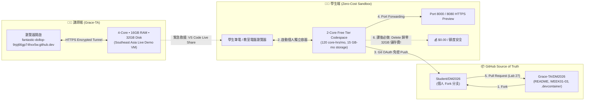

# ☁️ DM2026 — GitHub Codespaces from ZERO to HERO（90 分鐘實戰工作坊全量教材）

> **所屬帳號與專案倉庫**：[`Grace-TA`](https://github.com/Grace-TA) ／ [`Grace-TA/DM2026`](https://github.com/Grace-TA/DM2026)（115 學年第 1 學期《離散數學 Discrete Math.》）  
> **講師示範機主機（Live Demo Host）**：`https://fantastic-dollop-9rpj66gp74hxx5w.github.dev/`（**4-core • 16GB RAM • 32GB Disk**，`Southeast Asia` 區域，由 `Grace-TA` 計費）  
> **學生實作拓撲（Zero-Cost Sandbox）**：學生 **Fork `Grace-TA/DM2026` $\rightarrow$ 開啟個人 Free Tier `2-core` Codespace**（每月 `120 core-hours` = `60 小時`實測時間 + `15 GB-months` 儲存；課後 1 鍵 `Delete` 歸零計費）  
> **授課時數與節律**：**90 分鐘**高密度實戰工作坊，嚴格執行 **「10 分鐘核心拆解與 Live Demo + 5 分鐘學員動手破關」6 大心流循環**  
> **方法論合規宣言**：融合 `/grill-igs`（黃金基線保全）、`/study5`（五階後設認知與三階 11-Why 穿透）及 `/Professor's Workshop`（雙語教學結構、工匠隱喻、Bloom's L3–L6 與 L.A.W. 量化契約）。

---

## 🎯 一、 工作坊破局宣言：從「單格 Colab 孤島」躍遷為「雲端工業級開發艙」

在 [`Grace-TA/DM2026`](https://github.com/Grace-TA/DM2026) 前三週的課程脈絡中，同學已經走過了 [`WEEK01.md`](https://github.com/Grace-TA/DM2026/blob/main/WEEK01.md)（My first Google Colab）、[`WEEK02.md`](https://github.com/Grace-TA/DM2026/blob/main/WEEK02.md)（Python 101：`calendar`、`math`、`if-else`、字串清洗、`enumerate()`、`range()` 九九乘法表）以及 [`WEEK03.md`](https://github.com/Grace-TA/DM2026/blob/main/WEEK03.md)（迴圈、Dict/Set、函式、`try-except`、OOP 與 Matplotlib 三角波／圓參數式視覺化）。

然而，多數大一資工／電機／資管／資科新生只要離開瀏覽器裡的 Google Colab，就會撞上三道致命高牆：
1. **本機環境詛咒（"It Works on My Machine" Trap）**：Windows 路徑空白與中文編碼爆掉、macOS Python2/3 混戰、`pip` 權限錯誤，光是安裝環境就消耗 40 分鐘課堂時間。
2. **Colab 單格思維局限（Single-Notebook Island）**：無法體驗真實的**多檔案 Python 套件（`discrete_toolkit/`）**、無法執行 **`git commit -> push -> Pull Request`** 版本控制閉環、也無法對外開啟 **HTTP Port Forwarding** 展示互動式離散數學網頁。
3. **雲端容器黑箱與計費恐慌（Black-Box & FinOps Fear）**：誤以為 Codespaces 只是「網頁版記事本」，不知道背後是 **Docker DevContainer + 獨立 Linux VM + SSH/HTTPS 隧道**；更不知道「停止（Stop）Codespace 依然會對 32GB 虛擬磁碟計算儲存配額（`15 GB-months` 免費上限）」，若沒在課後 **Delete** 就會在下週收到配額耗盡警告！

**本 90 分鐘工作坊的工匠隱喻（Trade Metaphor）：「☁️ 雲端貨櫃鍛造艙（Cloud Container Forge）」**
- **Local PC / Chromebook** = 手推車（只負責開啟瀏覽器視窗，不再承受重型運算與環境污染）
- **GitHub Repository (`Grace-TA/DM2026`)** = 藍圖倉庫（所有離散數學程式碼與 `.devcontainer` 配方）
- **`.devcontainer/devcontainer.json`** = 標準化配方單（無論誰、在哪台電腦開啟，100% 鑄造出完全相同的 Python 3.12 + Jupyter + Matplotlib 容器）
- **GitHub Codespace (`2-core` / `4-core`)** = 隨開即用、用完可拆解回收的雲端鍛造貨櫃！

---

## 🧭 二、 工作坊全景資訊圖表（Infographic Overview Tables）

### 📊 表 1：本地環境 vs. Google Colab vs. GitHub Codespaces 三維工程對照表

> **核心戰略結論**：在「一般程式開發、演算法教學（如離散數學 `DM2026` 常用之 `NetworkX`、`SymPy`、`Z3` 僅需 CPU）、多檔案專案與軟體工程」上，**Codespaces 不僅能完全取代 Google Colab，而且功能更強大**；但在「需要免費 GPU（如 T4 GPU）訓練深度學習模型」的場景下，**兩者屬於互補關係**。

| 比較維度 | ❌ 本地筆電安裝（Local Setup） | 🟡 Google Colab（`WEEK01` 起手式） | ✅ GitHub Codespaces（本工作坊終極形態） | 對 `DM2026` 離散數學教學之戰略價值 |
|:---|:---|:---|:---|:---|
| **環境架構與 OS** | 異質 OS（Windows/macOS 路徑編碼紛亂） | 單一瀏覽器 Notebook 沙盒（階段性連線） | **完整 `Ubuntu 24.04.5 LTS (Noble Numbat)` 容器 + 完整 VS Code IDE** | 寫 `.py` 模組、CLI 與網站時必選 Codespaces |
| **Jupyter Notebook 支援** | 須手動裝 Jupyter + Kernel | 原生支援（免設定） | **原生支援**（預裝 `ms-toolsai.jupyter` 直接跑 `.ipynb` + **Debugger 斷點**） | 執行 `.ipynb` 同時擁有 Git 版本比對與中斷點除錯 |
| **硬體算力與場景分工** | 消耗自己電腦電量與硬碟 | 2-core CPU + ~12.7GB RAM（提供有限時數 **T4 GPU**） | **教師機 `4-core / 16GB RAM`・學生免費 `2-core / 8GB RAM`（無免費 GPU）** | `NetworkX` / `SymPy` / `Z3` 僅需 CPU，Codespaces 更快且不中斷 |
| **檔案持久化與 Git** | 須手動設定 SSH Key / Credential | 閒置約 90 分鐘斷線清空本機磁碟，須手動掛載 Drive | **`/workspaces/DM2026` 受 Persistent Volume 永久保護 + 原生 Git Push/PR** | 徹底解決忘記存檔或版本覆蓋問題（`rebuild` 不遺失） |
| **網頁與服務預覽** | `localhost` 僅本機可見 | 難以長期託管互動式 Web App | **一鍵 Port Forwarding**（Private / Org / Public HTTPS） | 即時分享集合論／真值表互動展示網 |
| **免費額度與計費防線** | 免費（個人設備折舊） | 免費 GPU 隨時限時斷線 | **個人 Free 帳號 120 core-hrs/月 + 15 GB-months** | **2-core = 60h/月；課後必須 `Delete` 歸零 32GB 儲存費！** |

---

### ⏱️ 表 2：90 分鐘「10+5」極速心流時間配當表（6 大循環）

> **教學設計定律（L.A.W. Compliance）**：IF 單段純講授超過 12 分鐘而無終端機實作驗證，THEN 大一新生之實作跟隨掉隊率將高於 25% `[HYPOTHESIS]`。因此 90 分鐘切割為 **6 個「10 分鐘教師 4-core 示範 + 5 分鐘學員 2-core 破關」微循環**！

| 時段區間 | 循環編號 | 10 分鐘講師示範焦點（`fantastic-dollop` 4-Core） | 5 分鐘學員必破關卡（Student Fork `2-core`） | 核心產出（DoD） | 對應冊別 |
|:---:|:---:|:---|:---|:---|:---|
| **00:00–00:15** | **Cycle 1** | **破冰揭秘與 5W1H/5-Why**：為何不可直接連老師的 `fantastic-dollop` URL？Fork 與 `2-core` 免費計算 | **Lab 01 & Lab 02**：Fork `Grace-TA/DM2026`、啟動 2-Core Codespace、執行 `lscpu` / `free -h` | 成功進入雲端 VS Code Web 並截圖硬體規格 | `01_5W1H`、`Lab 01–02` |
| **00:15–00:30** | **Cycle 2** | **雲端終端機與 Git 免密閉環**：揭示 OAuth Credential Proxy 如何免密 `git push` | **Lab 03, Lab 04, Lab 06**：建立 `feat/student-workshop` 分支、寫出首支 Python 腳本並 `push` 回 Fork | GitHub 網頁版成功看見新 commit | `PB-01/06`、`Lab 03–06` |
| **00:30–00:45** | **Cycle 3** | **Infrastructure-as-Code 核心**：解剖 `.devcontainer/devcontainer.json` 與 Container Rebuild | **Lab 07 & Lab 08**：檢視/撰寫 `devcontainer.json` 並執行環境檢查閘門 `verify_codespace_env.py` | 終端機輸出 `JSON` 全綠檢查報告 | `PB-03`、`Lab 07–08` |
| **00:45–01:00** | **Cycle 4** | **Port Forwarding 與 CLI 遙控**：示範 `8000` Port 公私切換與 `gh codespace` 指令集 | **Lab 09 & Lab 11**：啟動 `python3 -m http.server 8000`，用手機或分頁開啟轉發 HTTPS 網址 | 瀏覽器成功預覽雲端網頁 | `PB-05/06`、`Lab 09–11` |
| **01:00–01:15** | **Cycle 5** | **`DM2026` Colab 遷移實戰**：將 `WEEK02` 布林/9x9 與 `WEEK03` 集合/Matplotlib 搬進雲端貨櫃 | **Lab 15, Lab 16, Lab 22**：執行 `.ipynb` 核心、修復縮排 1135 真值表、輸出 `WEEK03` 三角波 PNG | Codespace 內直接預覽生成的 `.png` 圖表 | `Lab 15–22` |
| **01:15–01:30** | **Cycle 6** | **Hero 展演 + FinOps 歸零儀式**：示範 `pytest` 批改閘門、發起 PR，並現場示範「Stop vs Delete」救命術 | **Lab 24, Lab 27, Lab 28**：跑通 `pytest`、送出 PR 至 `Grace-TA/DM2026`、**Delete Codespace 歸零磁碟費** | PR 連結成立 + Codespaces 清單歸零 | `PB-09`、`Lab 24–28` |

> **課後自主破關設計**：課堂 90 分鐘內學員同步完成 **12 題核心必修 Labs**（`01, 02, 03, 04, 06, 07, 08, 09, 15, 16, 22, 28`）；其餘 **16 題進階與專題 Labs**（含 `gh` CLI、Secrets、Debugger 斷點、OOP 套件重構、Port 8080 互動集合溫氏圖、Dockerfile Prebuild、Copilot 重構）皆已配備完整 **Complete Context Prompt + 5–9 步學生指南**，供課後 1 週內自主破關領取 Hero 徽章！

---

### 🗂️ 表 3：七冊教材套件與可部署 DevContainer 清單（黃金基線結構）

| 冊次 | 檔案名稱 | 目標對象 | 核心內容摘要 | 驗收門檻 |
|:---:|:---|:---:|:---|:---|
| **冊 0** | [`README.md`](./README.md) | 教師 / TA / 學生 | 破局宣言、90m 10+5 時間配當、4 大資訊表、Mermaid 架構、28 Labs 地圖 | 零佔位符、連結完整 |
| **冊 1** | [`01_5W1H_5Why_and_Study5_DeepDive.md`](./01_5W1H_5Why_and_Study5_DeepDive.md) | 教師 / 進階學員 | Codespaces 5W1H 全解析、雙軌 5-Why、`/study5` 三階 11-Why 穿透、4 大理論與 IF–THEN 律 | L.A.W. 量化指標 + 消融表 |
| **冊 2** | [`02_Top10_Codespace_Playbooks.md`](./02_Top10_Codespace_Playbooks.md) | 全體學員 | `PB-01`–`PB-10` 十套標準作業程序（含 4-core/2-core 拓撲、Port、Secrets、FinOps 歸零） | Before/After + 量化數據 |
| **冊 3** | [`03_Labs_01_to_14_Zero_to_Cloud_IDE.md`](./03_Labs_01_to_14_Zero_to_Cloud_IDE.md) | 全體學員（基礎） | `Lab 01`–`Lab 14`：從 Fork 開箱、Linux 體檢、Git 閉環、DevContainer 到 FinOps/故障救援 | 每題 5–9 步 + 完整 Context Prompt |
| **冊 4** | [`04_Labs_15_to_28_DM2026_and_Hero_Capstones.md`](./04_Labs_15_to_28_DM2026_and_Hero_Capstones.md) | 全體學員（實戰） | `Lab 15`–`Lab 28`：無縫遷移 `DM2026` `WEEK01–03`（真值表、集合、OOP、Matplotlib）至 Hero PR | 每題內嵌真實 `DM2026` 代碼 |
| **冊 5** | [`05_Instructor_90min_Stage_Script.md`](./05_Instructor_90min_Stage_Script.md) | 講師 / `Grace-TA` | 00:00–90:00 逐分鐘台詞與轉場指令、`fantastic-dollop` 示範動線、10 大現場急救 SOP | 無死角覆蓋 90 分鐘 |
| **冊 6** | [`06_Student_QuickRef_and_Rubric.md`](./06_Student_QuickRef_and_Rubric.md) | 全體學員（案頭卡） | 單頁快捷鍵、`gh cs` 速查表、Colab vs Codespaces 速對卡、28 Labs 破關護照與評分尺 | 可雙面列印 A4 |
| **啟動包** | [`devcontainer_starter/`](./devcontainer_starter/.devcontainer/devcontainer.json) | `Grace-TA/DM2026` | 預配置 `devcontainer.json` + 神經符號環境檢核腳本 [`verify_codespace_env.py`](./devcontainer_starter/scripts/verify_codespace_env.py) | Python 實際跑通驗證 |

---

### 🗺️ 表 4：28 題 Classic Labs 全景能力地圖（Zero $\rightarrow$ Cloud $\rightarrow$ DM2026 Hero）

| 階段分區 | 題號範圍 | 核心主題與代表技能 | 課堂必做 (12題) | 課後挑戰 (16題) | 對應 Bloom's 最高層級 |
|:---|:---:|:---|:---:|:---:|:---|
| **Stage 1：雲端貨櫃覺醒** | `Lab 01`–`05` | Fork 啟動、2-core vs 4-core 硬體探針、Terminal、分支、VS Code Settings Sync | `01, 02, 03, 04` | `05` | L3 Apply |
| **Stage 2：IaC 與網路隧道** | `Lab 06`–`11` | 免密 Git 閉環、`.devcontainer.json`、Rebuild、Port Forwarding、上傳下載、`gh cs` | `06, 07, 08, 09` | `10, 11` | L4 Analyze |
| **Stage 3：資安、FinOps 與急救** | `Lab 12`–`14` | Secrets 防漏、120 核時與 32GB 儲存精算（Stop vs Delete）、容器毀損救援 | — | `12, 13, 14` | L5 Evaluate |
| **Stage 4：DM2026 Colab 遷移** | `Lab 15`–`22` | `WEEK01` Jupyter、`WEEK02` 1135 真值表/字串/`range` 除錯、`WEEK03` 集合/關係/OOP/Matplotlib | `15, 16, 22` | `17, 18, 19, 20, 21` | L5 Evaluate |
| **Stage 5：Hero Capstone** | `Lab 23`–`28` | Port 8080 互動溫氏圖、`pytest` 批改閘門、Dockerfile Prebuild、Copilot、PR 提交與歸零 | `28` | `23, 24, 25, 26, 27` | **L6 Create** |

---

## 🔄 三、 GitHub Codespaces 雙軌拓撲與執行架構圖（Mermaid Architecture）

---

## 🚀 四、 課前 60 秒部署指南（給 Grace-TA 的立即行動清單）

1. **將標準化環境放入 `Grace-TA/DM2026`**：將本工作坊目錄內的 [`devcontainer_starter/.devcontainer/devcontainer.json`](./devcontainer_starter/.devcontainer/devcontainer.json) 與 [`devcontainer_starter/scripts/verify_codespace_env.py`](./devcontainer_starter/scripts/verify_codespace_env.py) 複製進 `Grace-TA/DM2026` 的根目錄並 `git push`。
2. **驗證講師 4-Core 主機**：開啟 [`https://fantastic-dollop-9rpj66gp74hxx5w.github.dev/`](https://fantastic-dollop-9rpj66gp74hxx5w.github.dev/)，在終端機執行 `python3 scripts/verify_codespace_env.py`，確認 `4` 核心、`~16 GB` RAM、`numpy`、`matplotlib`、`pytest` 全數就緒。
3. **發佈學員課前網址**：請學生登入個人 GitHub 帳號，前往 [`https://github.com/Grace-TA/DM2026`](https://github.com/Grace-TA/DM2026) 準備按右上角 **Fork**（**切記**：不可讓學生點擊老師私有 `fantastic-dollop` 連結！）。

> **Director Sigma 結語**：「*工具決定初學者的恐懼上限，但結構化的環境配方決定工程師的自由下限。九十分鐘後，你們不再害怕換一台電腦程式就跑不動——因為整個開發宇宙已經裝進了你的瀏覽器分頁裡。*」 ☁️⚒️

---

  © 2026 iGS / Dr. Horace Chen — Muse Academy × Grace-TA/DM2026

